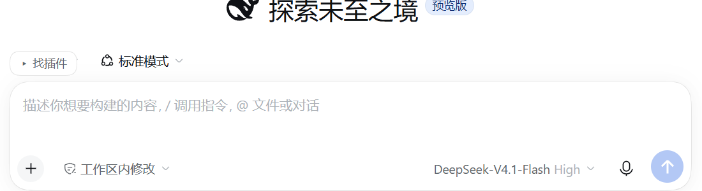
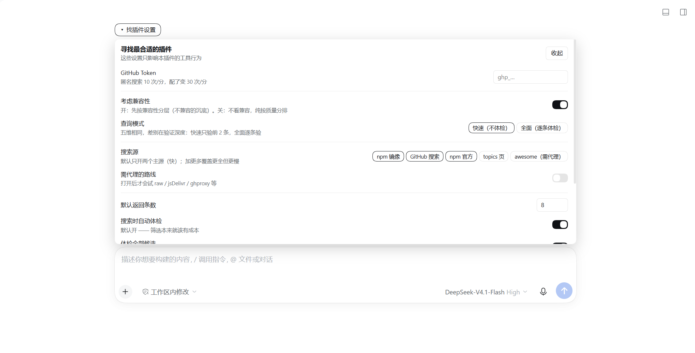

# dsh-plugin-best-fit · 寻找最合适的插件

> **在会话里搜 DSH 插件：先判「能不能装」，再比「哪个更好」。**
> 不兼容的当场标红沉底，能装的按五维质量分排序 —— 每条都给出为什么是这个分。

[English](#english) · MIT · `DSH >=0.2.0-0 <0.3.0` · 零运行时依赖 · 只读公开网络



---

## 为什么需要它

DSH 的插件生态已经很大（`topic:dsh-plugin` 下 **2 万+** 仓库、npm 上 **100+** 包），但踩坑的点只有一个：

**你装了个插件，结果什么都没发生。**

不是插件坏了，是 DSH 的**运行时门禁**把它挡了：`peerDependencies` 里 `@deepseek-ai/dsh*` 的范围对不上当前版本时，那一行会被直接 `disabled`，模块**永不导入**。表现就是“装上了，但界面上什么都没有”。

三个真实数据：

- 大量插件**根本没声明**版本要求（`engines.dsh` 和 dsh peer 都没有）→ 门禁不拦，但也没人保证它能用；
- 锁死在 `^0.1.x` 的插件，在 DSH 进入 0.2 之后会**永久失效** —— `dsh-find-plugin` 就是这样死的（它自己的 peer 写着 `^0.1.0-rc.6 || ...`，而现在的 DSH 是 `0.2.1-rc.5`）；
- 同名的包很多，光看星数和描述分不出哪个能装。

这个插件把「能不能装」变成一次调用，并且**先说结论，再给依据**。

## 30 秒上手

```bash
dsh plugin --profile web add dsh-plugin-best-fit
```

装完直接问：

```
find_dsh_plugin  query: "微信通知" limit: 3
```

真实输出（截取）：

```
[快速模式] 2/4 条已验证（590ms）｜可用 4 条 · 不兼容 0 条｜质量分（满分 60）

── 可用（4）──
1. @linxin666/dsh-update     42/60 分（活跃 25 / 人气 6 / 健康 6 / 风险 5）
   dsh plugin --profile web add @linxin666/dsh-update
2. dsh-sidebar-qa            42/60 分  ［兼容未验证］
   dsh plugin --profile web add dsh-sidebar-qa

── 不兼容 · 装了也用不了（0）──
```

不确定某一个？单独体检：

```
check_plugin_compat  target: dsh-find-plugin
```

```
❌ 不兼容 · dsh-find-plugin@0.4.0
当前 DSH：0.2.1-rc.5
判据字段：peerDependencies
结论：不满足 —— @deepseek-ai/dsh-tools 要求「^0.1.0-rc.6 || ^0.1.1-rc.1 || …」
建议：升级该插件、或留在匹配的 DSH 版本；强行安装会被门禁 disabled（模块永不导入）。
```

## 它凭什么说「最合适」

**两层判断，互不污染。**

### 第一层：兼容性 —— 门槛，不是分数

| 分层 | 含义 | 怎么处理 |
| --- | --- | --- |
| `ok` | `engines.dsh` 或 peer 范围覆盖当前版本 | 进「可用」组 |
| `unknown` | 没体检 / 取不到 package.json | 进「可用」组，标 `［兼容未验证］` |
| `blocked` | **版本不匹配** | 单独列最后，标 `⛔ 装不上` |

不兼容不进总分 —— 因为**连用都用不了的插件，人气再高也不该算「合适」**。

### 第二层：质量分（满分 60）—— 只在能装的里面比

| 维度 | 权重 | 依据 |
| --- | --- | --- |
| 活跃度 | 25 | 最近推送时间（7 天 / 30 天 / 90 天 / 180 天分档） |
| 人气 | 20 | 星数对数化（★100→10、★1000→15）；npm 源用 registry popularity |
| 维护健康 | 10 | open issue 占星数比例；仓库归档直接 0 |
| 风险 | 5 | 扣分项：安装期脚本 −5、归档 −3、peer 声明膨胀 −1 |

每条结果都带 `checklist`（为什么是这个分）和 `caveats`（该注意什么）：

```json
"qualityScore": 42,
"qualityParts": { "activity": 25, "popularity": 6, "health": 6, "risk": 5 },
"compatTier": "ok",
"compatLabel": "兼容（peer 范围）",
"caveats": ["没有公开人气数据"]
```

### 两种模式：差别在验证深度，不在维度

| | 快速（默认） | 全面 |
| --- | --- | --- |
| 判断维度 | 五维全算 | 五维全算 |
| 体检覆盖 | 前 2 条 | **逐条** |
| 实测耗时 | **118ms** | 1.9s |
| 未验条目 | 标 `［兼容未验证］` | 无 |

## 功能

- 🔍 **多源搜索** —— npm 镜像 / GitHub `topic:dsh-plugin` / npm 官方 / topics 页，串行降级，一家挂了不影响别的
- 🧪 **兼容体检** —— 按 DSH 门禁的真实规则判（`engines.dsh` 存在时只看它；否则逐个校验 dsh peer；预发布参与匹配）
- ⚖️ **五维质量分** —— 不是黑箱，每项都能看到为什么
- 🛡️ **不兼容一票否决** —— 沉底 + `⛔ 装不上`，不让你白装
- ⚡ **双模式** —— 快速 118ms 看个大概 / 全面逐条验到底
- 🎛️ **输入框浮窗配置** —— 点「▸ 找插件」就地改：模式、是否考虑兼容、搜索源、Token、条数
- 🌐 **内置 SOCKS5 代理** —— 零依赖手写客户端，自动探测 Windows 系统代理；加速器是 SOCKS5 也能用
- 📊 **结果卡片** —— 搜索结果显示成列表，每条带「详情」按钮展开五维分项

## 版本兼容

| DSH 版本 | 本插件版本 |
| --- | --- |
| `>=0.2.0-0 <0.3.0`（0.2.x 全线，含 rc） | `0.1.x` |

门禁看的是 `engines.dsh`：`>=0.2.0-0 <0.3.0`（下界的 `-0` 让 `0.2.0-rc.x` 也算进 0.2 线）。

## 配置

输入框上方的小按钮「▸ 找插件」→ 面板（宽度跟随输入框）：



| 项 | 默认 | 说明 |
| --- | --- | --- |
| 考虑兼容性 | **开** | 关掉就不体检、不分层，纯按质量分排 |
| 查询模式 | 快速 | 快速只验前 2 条；全面逐条验 |
| 搜索源 | npm 镜像 + GitHub + npm 官方 | 勾选启用哪些 |
| 需代理的路线 | 自动 | 探测到代理就放行；也能强制开/关 |
| 代理地址 | 自动探测 | 可手填 `socks5h://host:port` |
| GitHub Token | 空 | 匿名 10 次/分，配了 30 次/分。存 `credential.json`（0o600），界面只回显后 4 位 |
| 默认条数 / 体检条数 / 诊断信息 | 8 / 5 / 开 | — |

配置落在 `<DSH_HOME>/best-fit/config.json`，删掉即回默认。

## 和其他插件工具的区别

| | **best-fit** | `dsh-find-plugin` | `dsh-plugin-radar` |
| --- | --- | --- | --- |
| 搜索插件 | ✅ 多源 | ✅ | ✅ |
| 兼容性判定 | ✅ 三态 + 判据原文 | ❌ | ❌ |
| 不兼容的处理 | ✅ 沉底 + 标红 | ❌ | ❌ |
| 质量评分 | ✅ 五维、可解释 | ❌ | 部分 |
| 自身能否装在 0.2.1-rc.5 | ✅ | ❌（自己先被门禁挡了） | ❌ |

**这不是功能多寡的问题**：一个告诉你「有哪些插件」，一个告诉你「哪些你能用、为什么」。

## 最近更新

### 0.1.3 — 内置 SOCKS5 代理
- Node 的 `NODE_USE_ENV_PROXY` **只支持 HTTP 代理**，对 SOCKS5 无效 → 自己写了零依赖客户端（`node:net` + `node:tls` + 手写 HTTP/1.1）
- 必须 `socks5h`（远程 DNS）：实测 `socks5://` 全挂、`socks5h://` 全通
- 11 条外网路线实测 **10/11 可用**；`github-contents` 从「3.3s 或失败」变成 **1.26s 稳定成功**

### 0.1.2 — 兼容性独立成门槛
- 兼容性从「评分里的一项」改成**前置分层**，质量分改 60 制（不含兼容性）
- 新增「是否考虑兼容」开关
- 搜索结果卡片（评分 + 详情展开）

### 0.1.1 — 让评分有依据
- 五维评分上线；默认全量体检
- 过滤 `@deepseek-ai/*` 官方内部包（搜 `sidebar` 时它们会占满前排）

### 0.1.0 — 首次发布
- 两个工具 + 多源搜索 + 兼容体检

## 限制（诚实版）

- **未声明的插件 ≠ 能用**：`none` 只代表门禁不拦，作者没承诺过适配哪个版本
- **快速模式只验前 2 条**：第 3 条以后可能藏着不兼容的，想知道就用全面模式
- **拿不到 package.json 就判不了**：私有仓库、没发 npm、网络不通时只能人工核对
- **不评估代码安全**：不检查插件会读什么、会往哪写。安装任何第三方插件前请自己看一眼
- **星数不能代表质量**：monorepo 子包会继承父仓库星数，所以人气只占 20 分

## 开发

```bash
npm test        # 离线冒烟测试 53 条，不联网
```

架构、实测数据、踩过的坑见 [`docs/DEVELOPMENT.md`](docs/DEVELOPMENT.md)。

## English

**dsh-plugin-best-fit** — search DSH plugins inside the agent, and decide **whether you can install one before comparing which is better**.

- **Two-layer verdict**: compatibility is a **gate** (`ok` / `unknown` / `blocked`), not a score. Incompatible plugins sink to the bottom with `⛔`.
- **Quality score (60)**: activity 25 + popularity 20 + maintenance 10 + risk 5, only among installable candidates. Every number is explained.
- **Two modes**: `fast` (verifies the first 2, ~118ms) / `full` (verifies every candidate).
- **Zero runtime dependencies**, read-only public APIs, never installs anything for you.
- Requires `DSH >=0.2.0-0 <0.3.0`.

```bash
dsh plugin --profile web add dsh-plugin-best-fit
```

## 许可

MIT © k423Charotte
